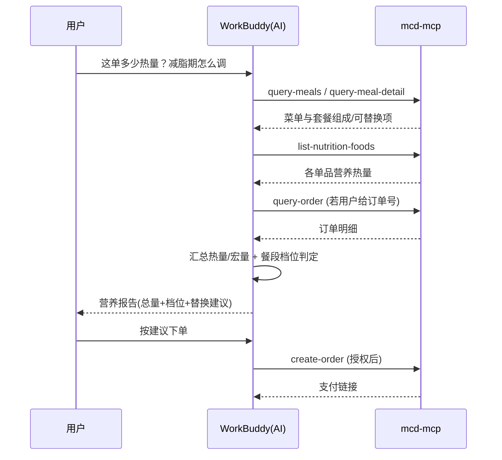

# 麦当劳 MCP 接入说明（MCP_INTEGRATION）

本项目**真实使用**麦当劳中国官方 MCP Server 提供的能力，所有菜单、营养、订单查询均通过该 MCP 完成。

## 1. 接入的 MCP Server

| 项 | 值 |
|---|---|
| 提供方 | 麦当劳中国（M-China，官方 GitHub 组织已验证） |
| Server 地址 | `https://mcp.mcd.cn` |
| 传输协议 | Streamable HTTP |
| 鉴权 | 请求头 `Authorization: Bearer <MCP Token>` |
| Token 获取 | <https://open.mcd.cn/mcp> 登录后「控制台 → 激活」复制 |
| 限流 | 每 Token 600 次/分钟（超了返回 429，需降频） |
| 官方指南 | <https://github.com/M-China/mcd-mcp-server> |

> Token **不入库、不写日志、不回显**；本仓库仅以环境变量占位符 `${MCD_MCP_TOKEN}` 出现（见 `mcp-config.example.json`）。

## 2. 实际使用的工具（Tool）

本 Skill 串联以下 `mcd-mcp` 工具（名称与官方一致），聚焦「控卡营养」场景：

| Tool | 用途 | 在流程中的阶段 |
|---|---|---|
| `query-nearby-stores` | 查附近门店 | 门店定位 |
| `delivery-query-addresses` | 查已存配送地址 | 外送准备 |
| `delivery-create-address` | 新增配送地址 | 外送准备 |
| `delivery-query-stores` | 查可配送门店 | 外送准备 |
| `query-meals` | 查在售菜单（分类/编码/标签） | 选品 |
| `query-meal-detail` | 查套餐组成/可替换项/营养 | 选品（核心） |
| `list-nutrition-foods` | 查营养热量 | 营养计算（核心） |
| `query-order` | 按订单号查明细 | 订单营养透视 |
| `calculate-price` | 替换后价格对比（可选） | 比价 |
| `campaign-calendar` | 查当月营销活动（轻食/限钠主题） | 大促联动 |
| `create-order` | 创建订单并返回支付链接 | 下单（授权后） |
| `query-order` | 查订单详情 | 下单核对 |
| `cancel-order` | 取消订单 | 下单后 |

> 以上为控卡主链路使用的工具；MCP 还提供优惠券、团餐、派对预约、积分商城、抽奖等能力，本项目按场景可扩展调用。

## 3. 调用流程

## 4. 业务价值

- **把营养透明化**：用户通常不知道一份套餐的热量 / 钠含量。Skill 一次性拉满并汇总，避免「吃完才发现有数」。
- **决策辅助**：用 `list-nutrition-foods` 真实营养对比替换方案，给出「为什么这单更低卡」的可解释结论，而非凭感觉。
- **降门槛**：自然语言即可完成「查营养 → 算总量 → 拿替换」，不需要用户逐屏翻 App 营养成分表。
- **可扩展**：同一套 MCP 连接可延伸到控糖、控盐、孕期营养等细分场景，Skill 是统一入口。

## 5. 合规

- 严格遵循《麦当劳 MCP 服务规则》：非商业用途、Token 妥善保管、不超频。
- 下单属敏感操作，Skill 内强制「用户显式授权」才调用，不做静默操作。
- 项目非麦当劳官方产品，输出以官方实时结果为准，不构成营养 / 医疗建议。
